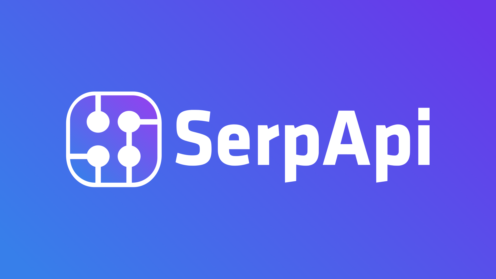

# Restish (downstream)

[](https://github.com/natalie-o-perret/restish/actions/workflows/ci.yml)
[](https://github.com/natalie-o-perret/restish/releases)
[](https://pkg.go.dev/github.com/rest-sh/restish/v2)
[](LICENSE.md)

Restish is a CLI for working with REST-ish HTTP APIs. It can make generic HTTP
requests, discover OpenAPI descriptions, generate API-aware commands, manage
profiles and auth, render structured output, follow pagination links, and run
plugins.

Restish v2 is the active release line. Users who need the legacy v1 line can
install `rest-sh/tap/restish@1`; see the
[v1 upgrade guide](https://rest.sh/docs/getting-started/upgrade-from-v1/).

This is Natalie Perret's downstream fork of
[rest-sh/restish](https://github.com/rest-sh/restish). The `downstream` branch
combines pending upstream contributions while keeping their PR branches separate.
These builds are not official Restish releases.

The downstream additions cover explicit raw output, richer security warnings,
API-backed completion and argument ordering, plugin selection and progress,
formatter configuration and interactive sessions, host formatter fallback, and
hidden request-body prompts, and opt-in response middleware such as
`--rsh-anonymize` when a compatible plugin is installed.

## Try It

Make a direct request with no setup beyond installing the CLI:

```bash
restish api.rest.sh/types
```

Then format, filter, and page through real API responses:

```bash
restish api.rest.sh/images -o table --rsh-columns name,format,self
restish api.rest.sh/example -f 'body.basics.{name, label, profiles}'
```

Example table output:

```text
name                       format  self
Dragonfly macro            jpeg    /images/jpeg
Origami under blacklight   webp    /images/webp
Andy Warhol mural in Miami gif     /images/gif
```

## Upstream Sponsors

A big thank you to our sponsor!

<div>
	<a href="https://serpapi.com/?utm_source=restish">
		
	</a>
	<h3>SerpApi: Web Search API</h3>
	<p>
		Access Google Search, Maps, Shopping, and other search engine data with a simple API by SerpApi.
	</p>
	<a href="https://serpapi.com/?utm_source=restish">Learn more</a>
</div>
<hr/>

## Install

Build this fork from source with Go 1.25.3 or newer:

```bash
git clone --branch downstream https://github.com/natalie-o-perret/restish.git restish-downstream
cd restish-downstream
go build -ldflags "-X github.com/rest-sh/restish/v2/internal/cli.Version=downstream-$(git rev-parse --short HEAD)" -o restish ./cmd/restish
./restish --version
./restish --help
```

Homebrew, mise's `restish` shorthand, and `go install` from `rest-sh/restish`
install upstream, not this fork. The Go module path stays unchanged for plugin
and embedder compatibility.

Downstream release archives belong to
[this fork's releases](https://github.com/natalie-o-perret/restish/releases).
Use a distinct prerelease tag such as `v2.3.0-natalie.1` when publishing.
This fork does not update the upstream Homebrew tap.

## Why Restish?

- Use one-off HTTP commands with good defaults for headers, content types,
  retries, caching, TLS, and output.
- Connect OpenAPI descriptions to get generated API commands, help, profiles,
  auth, and shell completion.
- Filter normalized responses with shorthand or jq, then render JSON, YAML,
  tables, CSV, NDJSON, lines, gron, images, and raw downloads.
- Follow pagination links and stream API data without writing boilerplate loops.
- Extend the CLI with plugins for bulk workflows, CSV, MCP, TLS signing, and
  custom API behavior.

## Documentation

- [Documentation Home](https://rest.sh/docs/)
- [Tour of Restish](https://rest.sh/docs/getting-started/tour/)
- [Install](https://rest.sh/docs/getting-started/install/)
- [Connect to an API](https://rest.sh/docs/getting-started/connect-to-an-api/)
- [Authentication](https://rest.sh/docs/guides/authentication/)
- [Plugins](https://rest.sh/docs/plugins/)
- [Upgrade From v1](https://rest.sh/docs/getting-started/upgrade-from-v1/)

## Plugins

Bundled plugins live in this repository and can be built alongside the main
CLI:

```bash
go build ./cmd/restish-bulk
go build ./cmd/restish-csv
go build ./cmd/restish-mcp
go build ./cmd/restish-pkcs11
```

Start with [Install and Use Plugins](https://rest.sh/docs/plugins/install-and-use/)
or [Plugin Quickstart](https://rest.sh/docs/plugins/quickstart/).

## Development

Build from this repository when developing Restish itself:

```bash
go build ./cmd/restish
./restish --help
./restish api.rest.sh/types
```

Run the normal development loop with:

```bash
go test ./...
```

Build the CLI and bundled plugins with:

```bash
go build ./cmd/restish
go build ./cmd/restish-bulk
go build ./cmd/restish-csv
go build ./cmd/restish-mcp
go build ./cmd/restish-pkcs11
```

Run the full integration suite before releases or larger CLI/plugin changes:

```bash
go test -tags=integration ./...
```

Development docs:

- [Contributing](https://rest.sh/docs/contributing/)
- [Development Setup](https://rest.sh/docs/contributing/development-setup/)
- [Release Packaging](https://rest.sh/docs/contributing/release-packaging/)
- [Design Docs](docs/design/README.md)
- [Docs Source](site/)

## License

Restish is released under the MIT License. See [`LICENSE.md`](LICENSE.md).
